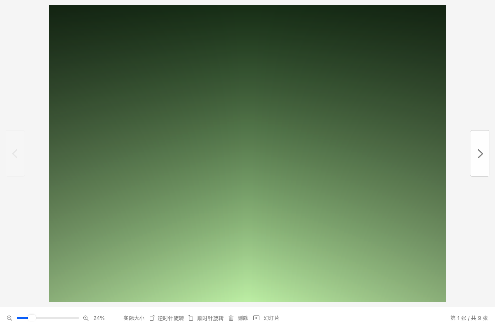

# 照片查看器

macOS 自带的预览不能直接用鼠标滚轮放大图片，看细节要换手势或点按钮。这个项目只解决这件事：滚轮指到哪就放大哪，双击在适应窗口与 100% 之间切换，按住拖动平移。

## 下载

在 Releases 页面下载最新的 ImgViewer dmg，打开后把 照片查看器 拖进应用程序。

https://github.com/buxuele/img_viewer/releases/latest

首次打开如果被系统拦截，右键选择打开，或在终端执行：

xattr -dr com.apple.quarantine "/Applications/照片查看器.app"

## 功能

1. 打开文件夹后按自然顺序浏览图片，支持 jpg、jpeg、png、gif、bmp、webp、tiff、heic、heif、avif、ico。
2. 滚轮以光标位置为中心平滑缩放，双击在适应窗口与 100% 之间切换，放大后可拖动平移，触控板支持双指捏合。
3. 支持旋转、删除进废纸篓、复制图片、复制路径、在访达中显示、另存为、设为桌面背景、属性与右键菜单。
4. 选项可设置打开时适应窗口、记住最近文件夹、滚轮缩放、双击切换、图片区背景。
5. 全屏幻灯片支持停留间隔、循环、随机顺序，以及黑色、白色、渐变三种主题。

## 安装

需要 macOS 14 或更高版本、Xcode 与 xcodegen。

brew install xcodegen

## 运行

./just_run.sh

脚本会生成 Xcode 工程、增量构建 Release 应用并在前台启动，终端保持占用直到应用退出。重复执行只会激活已经在运行的实例。

## 操作

左右方向键或 PageUp、PageDown 切换图片，加号减号缩放，Command+0 适应窗口，Command+1 实际大小，Command+R 顺时针旋转，Command+L 逆时针旋转，Delete 删除，F11 进入幻灯片，空格暂停，Esc 退出。

## 自动构建

推送 main 会运行逻辑测试、构建通用应用并上传 dmg 产物；推送 v 开头的标签会生成带 dmg 附件的 Release。

## 目录

1. Sources/ImgViewer 应用源码。
2. tests 逻辑测试，运行 bash tests/run_tests.sh。
3. scripts/package_dmg.sh 本地与 CI 共用的 dmg 打包脚本。
4. 效果图 界面截图。
5. docs/使用说明.md 完整操作说明。
